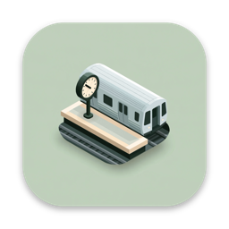
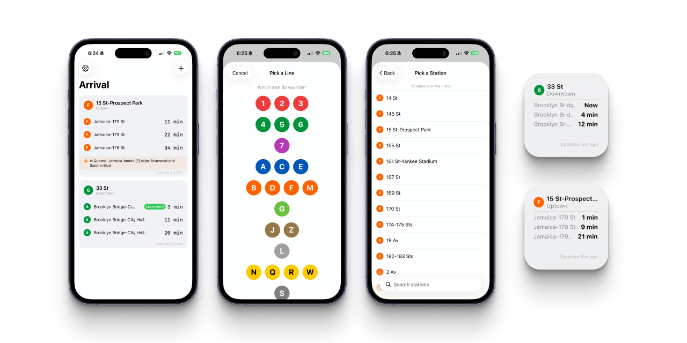

<h1>Arrival</h1>

Real-time NYC subway arrivals on your iPhone and in your Mac menu bar. 
Never miss your train.

  

I commute the same route every day. The only thing I actually need is when is the next train at my stop, on my line, going my direction.

## Apps

| App | What it does | Get it |
| --- | --- | --- |
| [Arrival for iOS](ios/) | Up to four saved stops, walking times, and home screen widgets that show the next trains you can still catch. iOS 17+. | [App Store](https://apps.apple.com/us/app/arrival-nyc-subway/id6759941751) |
| [Arrival for macOS](macos/) | A colored subway bullet in the menu bar. Click it for live countdowns and service alerts. macOS 13+. | [Latest release](https://github.com/madebysan/arrival/releases/latest) |

Both apps cover every subway line and roughly 496 stations. Data comes from the MTA's free [GTFS-Realtime feeds](https://api.mta.info/), the same source used by the countdown clocks in stations. No account, no analytics, no server.

## Repository layout

- [`ios/`](ios/): SwiftUI app with WidgetKit and AppIntents widgets. Open `ArrivaliOS.xcodeproj` in Xcode 16+.
- [`macos/`](macos/): Swift package for the `MenuBarExtra` app. Run `swift build -c release` inside `macos/`.

Privacy policy: [santiagoalonso.com/arrival/privacy](https://santiagoalonso.com/arrival/privacy)

## License

[MIT](LICENSE)

Made by [santiagoalonso.com](https://santiagoalonso.com)
